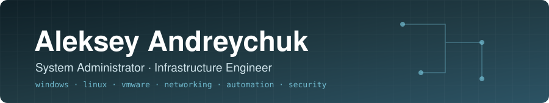

  

  Hands-on experience running <b>Windows and Linux infrastructure</b>, <b>virtualization</b> and <b>networks</b>. 
  Growing focus on <b>automation</b> and <b>information security</b>.

---

## 🛠️ Tech stack

  

  
  
  
  
  

| Area | What I work with |
|---|---|
| 🪟 **Windows** | Windows Server, Active Directory, Group Policy, PowerShell |
| 🐧 **Linux** | Linux administration, Nginx, HAProxy |
| ⚙️ **Automation** | PowerShell, Ansible |
| 🖥️ **Virtualization** | VMware |
| 🌐 **Networking** | L2/L3 fundamentals and troubleshooting |
| 📈 **Operations** | Monitoring, diagnostics, incident troubleshooting |

## 📂 Portfolio

<table>
  <tr>
    <td width="33%" valign="top">
      <h3>🏗️ <a href="https://github.com/alesdewq/infrastructure-engineering">Infrastructure Engineering</a></h3>
      Notes, practical templates and anonymised troubleshooting case studies: virtualization,
      Windows Server / AD, Linux, networking, monitoring.
    </td>
    <td width="33%" valign="top">
      <h3>🤖 <a href="https://github.com/alesdewq/projects-and-automation">Projects &amp; Automation</a></h3>
      Personal tools for read-only infrastructure inventory, Active Directory auditing and
      routine admin automation — each with an honest status.
    </td>
    <td width="33%" valign="top">
      <h3>🛡️ <a href="https://github.com/alesdewq/cybersecurity-learning">Cybersecurity Learning</a></h3>
      My path towards penetration testing: lab reports from my own isolated lab, notes and a
      learning journal.
    </td>
  </tr>
</table>

## 🚀 Selected projects

| Project | Status | What it does |
|---|---|---|
| [**VMware Inventory Collector**](https://github.com/alesdewq/projects-and-automation/tree/main/VMware-Inventory-Collector) | 🟢&nbsp;Functional | Read-only inventory of vCenter objects and subnets → JSON / CSV / Markdown |
| [**AD Audit Toolkit**](https://github.com/alesdewq/projects-and-automation/tree/main/AD-Audit-Toolkit) | 🟡&nbsp;Experimental | Read-only collection of Active Directory structure (OUs, users, groups, computers) → JSON |
| [**InfraScope**](https://github.com/alesdewq/projects-and-automation/tree/main/InfraScope) | ⚪&nbsp;Planned | Read-only infrastructure inventory with configuration checks |

🟢 Functional · 🟡 Experimental · ⚪ Planned

## 📚 Currently learning

- 🔐 **Information security** — network fundamentals, Linux and Windows security, Active Directory security
- 🧪 **Penetration testing methodology** — only in my own isolated lab environments
- ⚙️ **Infrastructure automation** — Ansible and PowerShell
